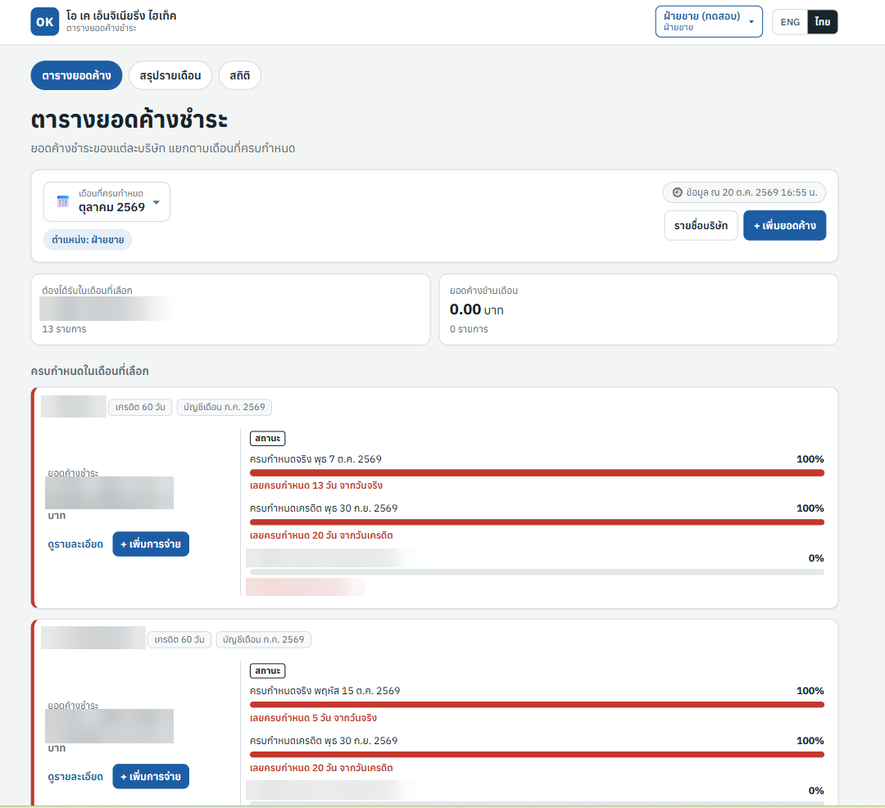
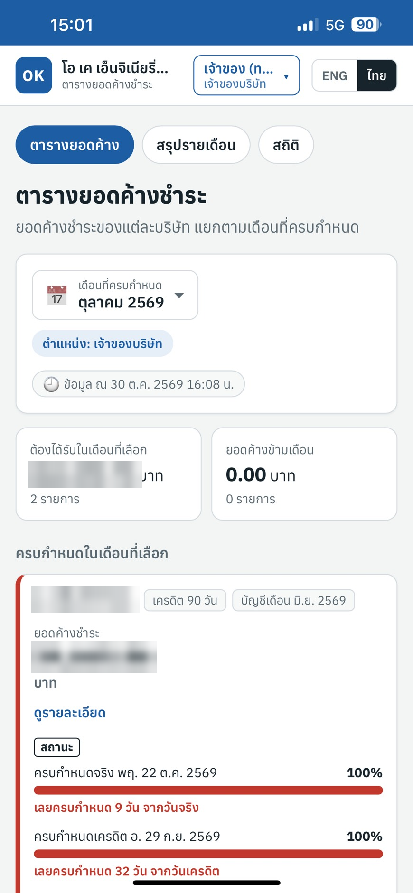
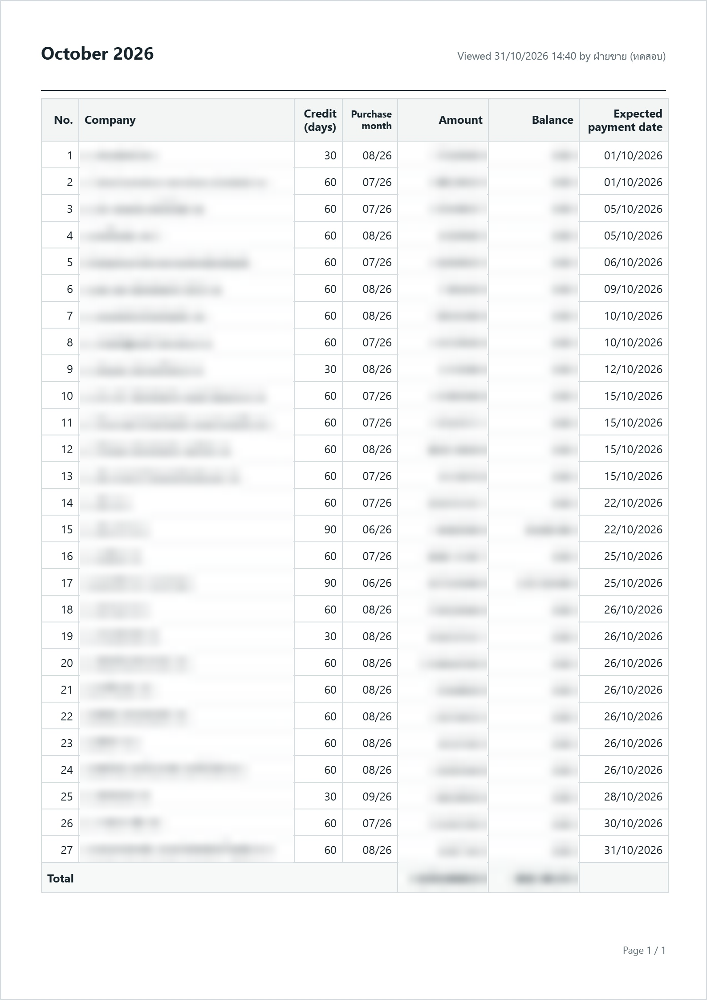
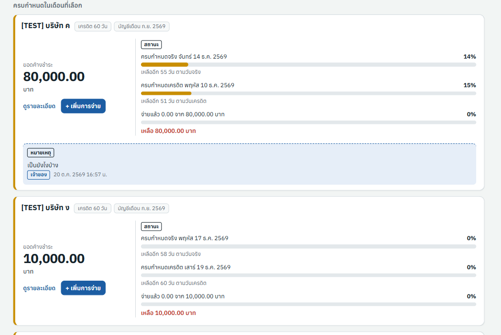
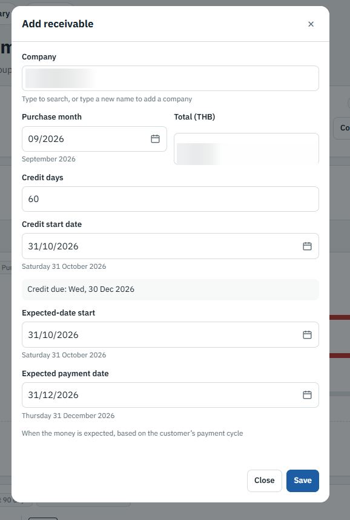
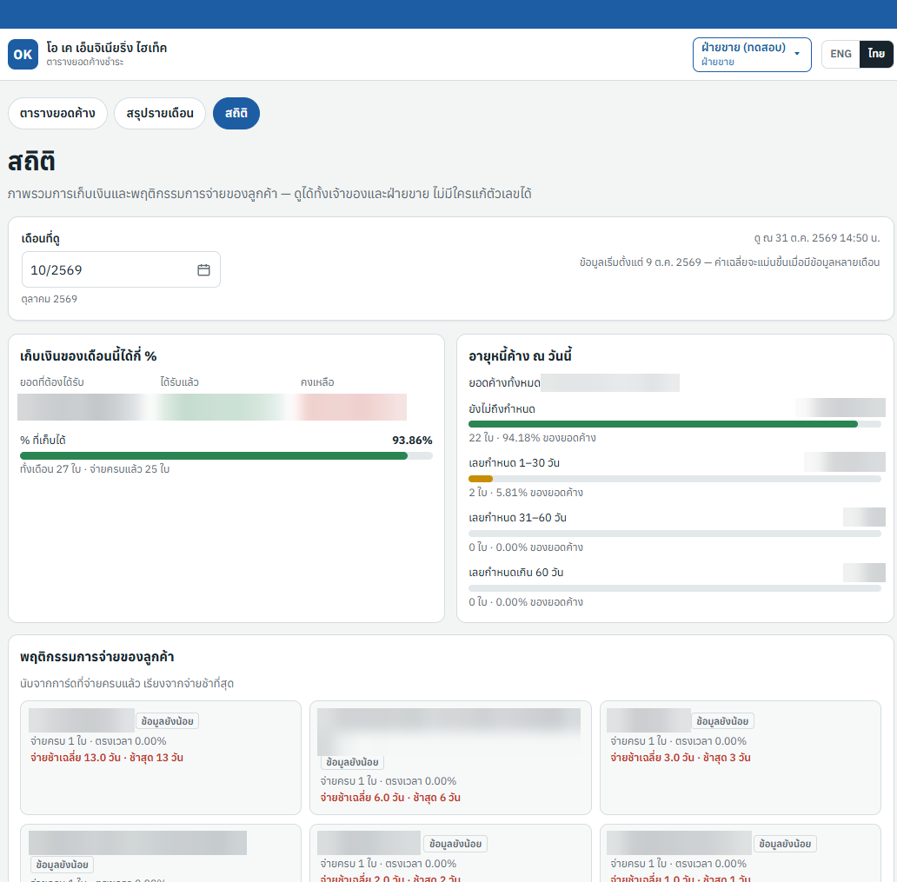
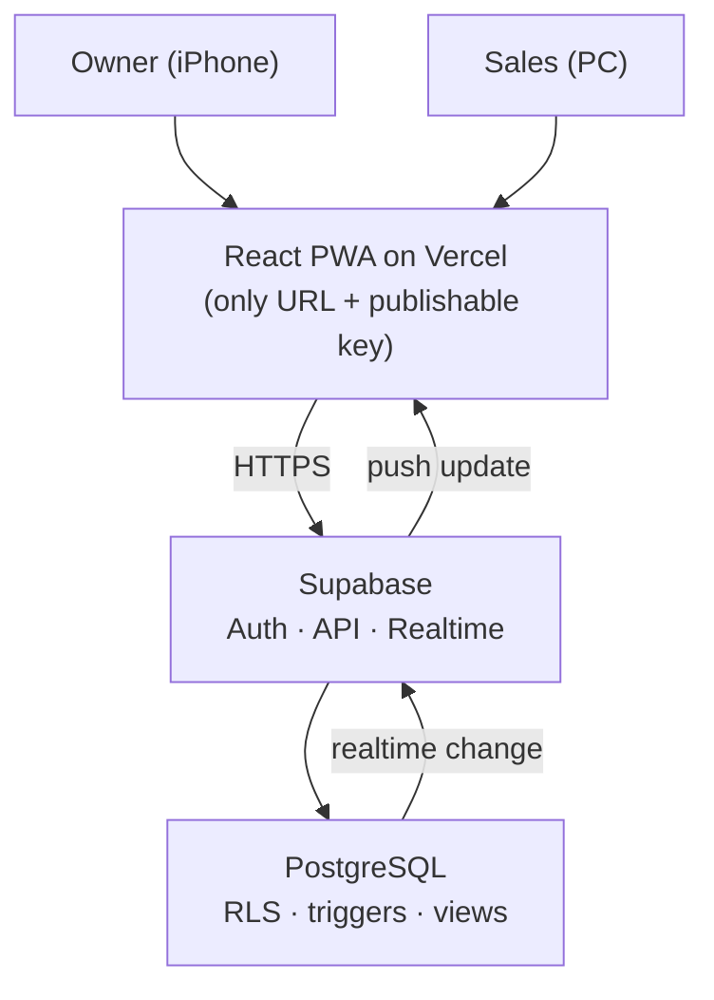

# OK Receivables Tracker

**▶️ From paper reports to live balances on the owner's phone ◀️**

A multi-user Progressive Web App that replaced a paper receivables report for a real, paying client, built in 3 weeks and 3 versions with an AI coding agent.

> Final Capstone, *Prompt Engineering* course, KMITL (Oct 2026)
> Team: Kongphob Onnom · Krijirat Thongbunlorm

---

## Table of contents

- [Overview](#overview)
  - [The problem](#the-problem)
  - [Results](#results)
- [Screenshots](#screenshots)
- [Key features](#key-features)
- [Tools / Technologies](#tools--technologies)
- [How things work](#how-things-work)
- [Security and data rules](#security-and-data-rules)
- [How it was built with AI (prompt engineering)](#how-it-was-built-with-ai-prompt-engineering)
- [Testing](#testing)
- [Version history](#version-history)
- [How to set up](#how-to-set-up)
- [Project structure](#project-structure)
- [Lessons learned](#lessons-learned)
- [What's next](#whats-next)

---

## Overview

**OK Receivables Tracker** is a full-stack, multi-user web app for O.K. Engineering Hi-Tech Co., Ltd., a wholesaler of electrical and plumbing supplies that sells to companies on credit.

- **Sales** (on a PC) records invoices and every payment.
- **The owner** (on an iPhone) sees every balance live, who is late, and the monthly report, and can message sales on any card. She cannot change any money.

The app installs on the home screen like a native app (PWA), updates in real time across devices, and keeps every number and every permission inside the database.

### The problem

Every month, sales typed a paper table of receivables for the owner. The paper showed only totals:

- ❌ who has paid part of a bill, and how much is still owed
- ❌ who is close to the due date, or already late
- ❌ how many payments, on which dates, by which method

The owner works away from the office, so she called sales about **3 times a week** to ask *"has the money arrived?"*

### Results

| | Before | After |
|---|---|---|
| Owner calls asking "has the money arrived?" | 3 per week | **0** |
| Time to make the monthly report | 30 min per month | **1 click** (PDF / JPG) |
| Client accounts on paper | 25 | **0** (all 25 moved into the app) |
| User rating (in-app, both users) | – | **5 / 5** on V1 and V2 |

> Measured during the first weeks of real use (Oct 2026).

---

## Screenshots

| Receivables list (PC) | Owner on iPhone | Monthly report |
|---|---|---|
|  |  |  |

| Owner's note to sales | Add a card (date fields) | Statistics |
|---|---|---|
|  |  |  |

*Customer names and amounts are blurred for privacy. The note screenshot uses `[TEST]` demo data.*

---

## Key features

- **Live receivables list:** one card per company per month, with three progress bars (time to the actual due date, credit time used, and money paid). Filter by month, show all, or show unpaid only.
- **Payments:** transfer or cheque, partial payments, and over-payment blocked in both the app and the database.
- **Thai date field:** typed `dd/mm/yyyy`, accepts Buddhist or Gregorian years, and spells out the full date under the field so typos are caught before saving.
- **Edit history:** who changed what, when, and old value → new value, written automatically by database triggers.
- **Owner ↔ sales notes:** the owner writes on any card from her phone, and the note shows in blue on sales' screen with no refresh. Notes are append-only.
- **Monthly report + export:** same columns as the old paper report plus a balance column, a "viewed at … by …" stamp, and A4 export to PDF or JPG (share sheet on phones, direct download on PC).
- **Customer statistics:** collection rate, 4-bucket debt aging, late payers ranked by on-time %, and where the money is stuck (top 5 balances).
- **Installable PWA:** home-screen icon, update banner, and an offline warning instead of stale numbers.
- **In-app feedback:** the same questions every week, with the app version attached automatically, so V0.1, V1 and V2 can be compared.

---

## Tools / Technologies

- **Frontend:** [React](https://react.dev/) + [Vite](https://vite.dev/), React Router, [vite-plugin-pwa](https://vite-pwa-org.netlify.app/)
- **Backend:** [Supabase](https://supabase.com/) (Auth, auto-generated API, Realtime)
- **Database:** [PostgreSQL](https://www.postgresql.org/) with Row-Level Security, triggers and views
- **Export:** html-to-image + jsPDF (lazy-loaded)
- **Hosting / CI:** [Vercel](https://vercel.com/), which deploys automatically on every push to `main`
- **AI coding agent:** [Claude Code](https://www.anthropic.com/claude-code)
- **Linting:** oxlint

---

## How things work



1. A user logs in with email and password. Sign-up is disabled, so only accounts we create can log in.
2. Every request carries the user's login token. **PostgreSQL Row-Level Security** checks the user's role (`owner` or `sales`) on every row, for every read and write.
3. Sales adds a receivable card or a payment. A trigger fills in who and when, and another writes the change to `audit_logs`.
4. Balances, the monthly report and statistics are **SQL views**. They are calculated in the database on every read and never stored or calculated in the app.
5. Supabase Realtime pushes the change to every open device, so the owner's phone updates within seconds.

**Data model (8 migrations)**

```
companies ──< receivables ──< payments
                   │
                   └──< receivable_notes   (append-only)

profiles      role: owner | sales, is_active
audit_logs    old → new, written only by triggers
app_feedback  score, app version (append-only)
```

---

## Security and data rules

- **Permissions live in the database, not the UI.** Hiding a button is not security. Every table has RLS, and roles are checked through `public.my_role()`.
- **The owner is read-only for money.** She can read everything and add notes, but she cannot change amounts or dates.
- **Nothing is ever deleted.** There are no DELETE policies. Records are cancelled (`is_cancelled`) or deactivated (`is_active`), so the history stays complete.
- **Every change is audited** by triggers. The app cannot write to `audit_logs`.
- **No secrets in the client.** Only `VITE_SUPABASE_URL` and the publishable key reach the browser.
- **Test data stays separate.** Test accounts and `[TEST]` companies are excluded from statistics and feedback reports.

---

## How it was built with AI (prompt engineering)

The course required an AI agent to be the main developer. Our job was to **give it the right context, split the work, and verify the results.**

**1. Context before code.** Six documents act as the agent's long-term memory:

| File | Purpose |
|---|---|
| [`AGENTS.md`](AGENTS.md) | Standing rules: security, no-delete, "if docs disagree, STOP and ask" |
| [`docs/prd.md`](docs/prd.md) | What and why, based on interviews with the owner and sales |
| [`docs/schema.md`](docs/schema.md) | Database blueprint: types, timezone, triggers, RLS |
| [`docs/architecture.md`](docs/architecture.md) | How the parts connect and deploy |
| [`docs/implementation-plan.md`](docs/implementation-plan.md) | Milestones M0–M7, V1 and V2, matched to class deadlines |
| [`docs/progress.md`](docs/progress.md) | Work log: what was done, which files changed, how it was tested |

**2. Small milestones.** One milestone per session, tested with both an owner and a sales account, and the agent never started the next one unless asked.

**3. Plan, review, then execute.** We read every plan before the agent wrote code. For example, a review caught that a cheque-feature migration would break the live app, so we split it into an *expand* step and a *contract* step.

**4. Explicit stop points.** For example, *"Stop before commit"*, so every change was reviewed before it reached the live app.

**5. Proof, not promises.** Each feature came with SQL tests that report `ALL PASS` or exactly what failed.

---

## Testing

Automated SQL checks run in the Supabase SQL Editor. Each check logs in as a test owner or test sales account, creates fake data with known answers, compares what the database calculates, and then removes the fake data.

| Test file | Covers | Result |
|---|---|---|
| `supabase/tests/stats_checks.sql` | Statistics views, debt aging, permissions | **71 / 71 PASS** |
| `supabase/tests/v2_checks.sql` | Monthly report totals, ordering, carry-over | **34 / 34 PASS** |
| `supabase/tests/owner_notes_checks.sql` | Notes: who can write, append-only | **25 / 25 PASS** |
| `m1`–`m5`, `v1_checks.sql` | Earlier milestones: roles, core tables, balances, Thai date fix | PASS |

We also tested on real devices: an iPhone (Safari, installed PWA, PDF share sheet), a Windows PC (direct download), and two devices updating in real time.

---

## Version history

| Version | Date | Driven by | Added |
|---|---|---|---|
| **V0.1** | 7 Oct 2026 | Interviews | Login + roles, cards, payments, edit history, PWA, realtime |
| **V1** | 14 Oct 2026 | First week of real use | Thai date field (dates were being saved day/month swapped), add payment from the card, in-app feedback |
| **V2** | 21 Oct 2026 | Owner + instructor feedback | Monthly report + PDF/JPG export, owner → sales notes, customer statistics |

---

## How to set up

**Requirements:** Node.js 20.19+ or 22.12+ (required by Vite 8), a Supabase project, and optionally a Vercel account.

1. **Clone and install**
   ```bash
   git clone https://github.com/doypuy-dotcom/ok-receivables-tracker.git
   cd ok-receivables-tracker
   npm install
   ```
2. **Environment variables.** Copy `.env.example` to `.env.local` and fill in:
   ```
   VITE_SUPABASE_URL=...
   VITE_SUPABASE_PUBLISHABLE_KEY=...
   ```
   **Note:** never put the `service_role` / secret key here.
3. **Database.** In the Supabase SQL Editor, run every file in `supabase/migrations/` **in order** (`001` → `008`).
4. **Users.** Create users in Supabase Auth (sign-up is disabled), then set each user's `role` (`owner` / `sales`) in `public.profiles`.
5. **Run locally**
   ```bash
   npm run dev
   ```
6. **Deploy.** Import the repo into Vercel and add the same two environment variables. Every push to `main` deploys automatically.

**Note:** the migrations are additive ("expand" first, "contract" later), because one database serves both local development and production.

---

## Project structure

```
ok-receivables/
├── AGENTS.md / CLAUDE.md     # rules for the AI agent
├── docs/                     # prd, schema, architecture, plan, progress
├── public/                   # PWA icons, manifest assets
├── src/
│   ├── auth/                 # login session + route guard
│   ├── pages/                # list, card detail, monthly report, statistics, login
│   ├── components/           # ReceivableCard, NotesPanel, ReportSheet, StatBar, ...
│   └── lib/                  # supabase client, data access, export, Thai dates, i18n
└── supabase/
    ├── migrations/           # 001 → 008
    ├── tests/                # automated SQL checks
    ├── queries/              # feedback report
    └── seed/                 # [TEST] demo data + cleanup
```

---

## Lessons learned

- **Real use finds the real bugs.** Almost every issue (swapped dates, cut-off names, the Windows share sheet) came from the client using the app, not from us testing at a desk.
- **Show the fix before shipping it.** The client rejected our first date-field fix before release, which saved a version.
- **Let the client set the target.** Our own "1 calendar day" target gave 40%. The owner's "next working day" target gave 90%.
- **With AI, the context is the product.** Clear specs and rules mattered more than clever prompts, and the tests were how we trusted the output.

---

## What's next

- **Cheque details** (bank, branch, cheque number, cheque date), with the first cheque's date treated as the real due date. This is designed and parked on branch `feature/cheques`.
- More months of data, so the statistics become more meaningful.
